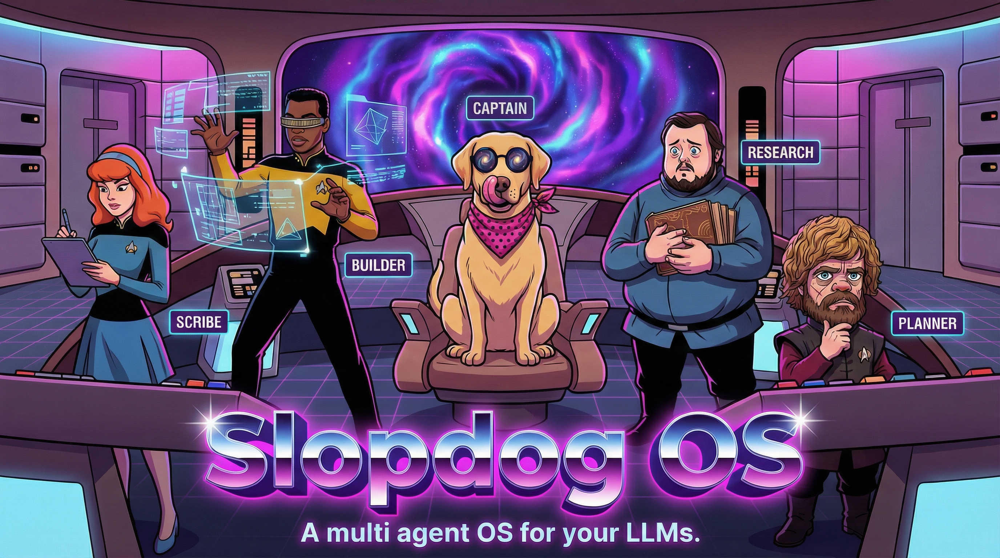

# Slopdog

A desk-based harness for running a small team of AI agents on Claude Code.



Slopdog splits the work of building software among agents that each sit at a **desk** with one
job: one talks ideas through and writes tickets, one runs the sprint, several build, and others
research, answer Slack or keep watch. Work moves as **tickets** grouped into **batches**, a single
**build ladder** file decides which model builds a ticket and which model checks it, and **gates**
(scripts and hooks that exit non-zero) refuse work that is not ready. This repo holds the harness
itself: the rules the agents load, the skills they run, the hooks that enforce the rules, and the
scripts that drive the pipeline.

It is published to read and borrow from rather than to install as-is. Paths inside the files read
`~/slopdog/v2/...`, which is this repo's root, and several scripts expect the rest of a running
house (a tasks repo with the tickets, a board, terminal panes per desk).

## How work flows

```
idea ──► Ideas desk ──► project ─► batch ─► tickets ──► Build desk ──► builder ──► verifier ──► main
          scores it      (one feature per batch)        dispatch gate   (worktree)   (fresh model)
          to 8/10                                       refuses or sends
```

| Stage | Who | What comes out | What can refuse it |
| --- | --- | --- | --- |
| Ideation | Ideas desk (Daphne) | Threads scored to eight out of ten, parked in an intake folder | Nothing yet: this is prose, and the comparison below says so |
| Sprint planning | Ideas desk with Todd | A project, a batch, tickets with points and typed acceptance criteria | Template heading checks (`scripts/lib/check-template-headings.mjs`) |
| Dispatch | Build desk (Tyrion) | One ticket sent to one builder in its own git worktree | `dispatch-gate.mjs`: about twenty-five refusals |
| Build | A builder from the ladder | Commits, one per step | Write fence, lane lock, shared-tree git guard |
| Verify | A fresh verifier session | `GREEN` merges to main; `RED` is a strike | Two strikes send the ticket to the senior builder (Data) |

Anything smaller than a ticket is a **quick task**, done by whichever desk received it, with no
batch, builder or verifier (`/slopdog:quick-task-add`, `/slopdog:quick-task-do`).

## The shape

**Desks.** A desk is a folder with its own `CLAUDE.md`, a persona and one job, and `lanes.json` is
the registry of every desk and sidekick with its model, engine and skills. The main desks are Ideas
(Daphne), Build (Tyrion), the builders (LaForge, Data and cheaper sidekicks), Research (Samwell
Tarly), Slack (Varys), IT (Scotty), QA, the Captain (Slopdog, the front door for status) and the
Watcher (usage limits and stuck desks). Desks reach each other by `SendMessage` first, then by a file
in the other desk's `inbox/` (`scripts/inbox-write.mjs`), and only as a last resort by typing into a
named terminal pane. `rules/desk-standard.md` says what every desk folder holds.

**Tickets and batches.** The taxonomy is department, project, feature, batch, ticket, and each word
means one thing (`rules/vocabulary.md`). A project opens with a short why, what and how; a batch
delivers one feature; tickets are sharded from a batch with a Fibonacci estimate, acceptance
criteria typed as unit, end-to-end, logger, live or human, and a readiness block. Only the word
"ticket" routes work to the Ideas desk (`rules/critical-rules.md`).

**The build ladder.** `config/build-ladder.json` decides who builds and who verifies by the
ticket's points, and `config/build-ladder.md` explains it. Today, tickets of one to three points
build on Sonnet at medium effort and are verified by Opus at low effort, five-point tickets build
on Sonnet high and verify on Opus medium, and eight points or two failed verifies go to Data on
Opus high. Subagents pick a tier from `config/subagent-tiers.md`, a hook refuses an `Agent` call
that names no model, and `scripts/check-build-ladder.mjs` fails when a script hardcodes a value the
ladder owns.

**The gates.** The rules that matter most are enforced in code rather than left to the model:

- `scripts/dispatch-gate.mjs` refuses a ticket that is outside the focus list, has no estimate,
  carries a stale assumption, has a placeholder Verify line, or is over its department's weekly
  token share.
- `plugins/slopdog/hooks/context-rot.mjs` is the context gauge: it names a tier on every prompt and
  refuses prompts at the hard limit until the desk clears. `sprint-stop.mjs` stops the week's spend,
  `agent-model-guard.mjs` checks subagent models, and `lane-lock.mjs` stops two desks editing one
  file blind.
- `scripts/shared-tree-git-guard.mjs` refuses `git stash`, a branch checkout, and a commit that
  does not name its paths, in the working tree every desk shares. `git-hooks/commit-msg.mjs`
  enforces the commit format in `rules/commits.md`.

**Clearing.** A desk never waits for compaction. At a landed step it writes `PICKUP.md`
(`/slopdog:clear-to-close`), clears itself (`scripts/self-clear.mjs`) and resumes from the note
(`/slopdog:pickup`), as `rules/desk-clear.md` describes. The same mechanism is packaged on its own
as [claude-pickup](https://github.com/morrillt/claude-pickup).

## What is in the repo

| Path | What | Start with |
| --- | --- | --- |
| `rules/` | The rules every desk loads, plus templates for the mission and department directives. | `principles.md`, `output-style.md`, `before-asking-todd.md`, `critical-rules.md` |
| `config/` | The build ladder and the subagent tier card. | `build-ladder.md` |
| `lanes.json` | The desk registry. | the `ideas` and `build` entries |
| `desk-standing-context.json` | The standing lines each desk role is handed on every session start. | |
| `plugins/slopdog/` | The Claude Code plugin. Skills in four groups (`session`, `writing`, `reports`, `meta`), hooks, and `bin/`. Every skill runs as `/slopdog:<name>`. | `session/ideate`, `session/sprint-planning`, `session/build-ticket`, `writing/batch-writer`, `hooks/README.md` |
| `scripts/` | The pipeline scripts and the library they share. | `scripts/README.md`, `dispatch.mjs`, `ready-queue.mjs` |
| `git-hooks/` | The commit-message hook. | |
| `docs/` | Write-ups. | [pstack beside the house pipeline](docs/pstack-comparison.md) |

## Trying it

You need Claude Code and a recent Node (the scripts are tested on Node 24).

```bash
git clone https://github.com/morrillt/slopdog-os
cd slopdog-os && npm install          # one dependency, js-yaml
claude --plugin-dir ./plugins/slopdog # load the skills and hooks for one session
```

To keep it loaded, symlink `plugins/slopdog` to `~/.claude/skills/slopdog`. The skills and hooks
read the rules from `~/slopdog/v2`, so the closest fit is to clone this repo there, or to adapt
the paths. Scripts are plain Node (`.mjs`) with a header comment saying what each one does, and
tests sit beside them (`node --test <file>.test.mjs`).

## Compared with pstack

[docs/pstack-comparison.md](docs/pstack-comparison.md) sets this pipeline beside pstack, the Cursor
plugin by @poteto. pstack routes a task to one of twenty-three well-written playbooks and nothing in
it refuses; Slopdog has about thirty-two refusals, all of them after a ticket exists. Each wins on
different dimensions, and neither guards the decision that matters most: whether the work should
exist at all.

## History

The earlier Cursor-based version (modes and personas driven by slash commands) is kept at the
`v1-cursor` tag.

## License

MIT. See [LICENSE](LICENSE).
