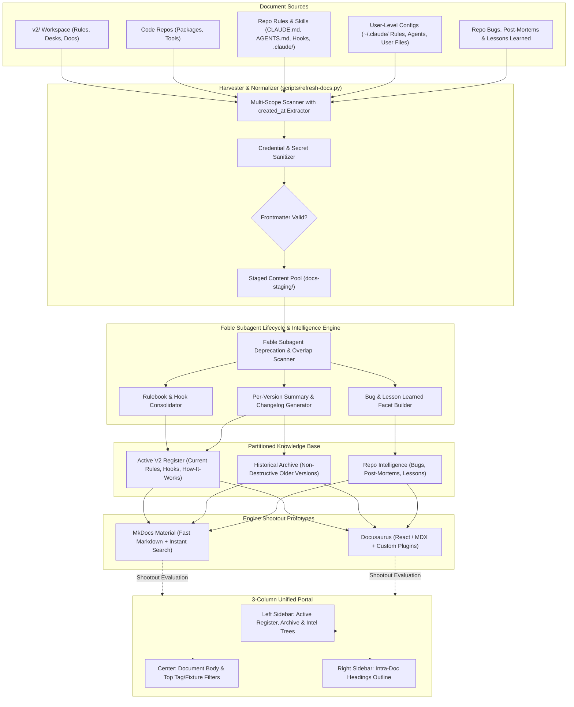

# Canonical Example: Slopdog BetterDocs Documentation Viewer

## Project Metadata
* **Project Type:** Documentation / Viewer / Harvester Infrastructure / Knowledge Intelligence
* **Desk:** writing
* **Status:** Active
* **Owner:** Todd
* **Functional Purpose:** Centralized documentation portal and multi-repo harvesting pipeline consolidating framework rules, skills, hooks, reports, and user-level .claude configs into an active V2 register, versioned archive, and repo intelligence knowledge base.

***

# Slopdog BetterDocs Documentation Viewer

> **Status:** `Active` | **Desk:** `writing` | **Priority:** `High` | **Owner:** `Todd` | **Ready for Shards:** `false`

## Summary

- **What:** 
  - A centralized documentation portal consolidating all scattered Markdown documents across SlopDog repositories and user-level configs—including framework rules (`CLAUDE.md`, `AGENTS.md`), skills, hooks, architecture reports, repo `.claude/` files, and global `~/.claude` user configs.
  - An interactive 3-column viewer that cleanly separates the authoritative **V2 Active Register** (cohesive current rules, hooks, and system workflows) from an immutable **Historical Archive** of older versions without deleting any documentation.
  - An intelligent post-harvest curation pipeline where **Fable** deploys subagents to evaluate document age (`created_at`), identify deprecated or mergeable docs, compile a unified evolution changelog with per-version summaries, and catalog repo bugs and lessons learned for AI indexing.
- **Why:** 
  - **Eliminate Knowledge Drift & Agent Confusion:** Prevents obsolete or contradictory rules and legacy docs from polluting active workspaces by establishing a single source of truth for V2 rules while keeping historical docs accessible.
  - **Complete Auditability Without Deletion:** Retains SlopDog’s full architectural evolution across all versions through synthesized version summaries and a consolidated changelog referencing archived source files.
  - **Structured AI Retrieval & Future Reporting:** Standardizes frontmatter timestamps (`created_at`), tags, and fixtures across all reports, bug post-mortems, and lessons learned to enable high-accuracy semantic search and agent context injection.
- **How:** 
  - Conduct a side-by-side prototype shootout between Docusaurus and MkDocs Material, feeding both from a common staging folder to evaluate UI polish, search, and archive partition handling.
  - Extract filesystem and git creation timestamps (`created_at`) during multi-scope harvesting to power Fable's downstream subagent audit, clustering docs into active V2 vs. archived legacy tiers.
  - Build automated synthesis scripts to merge redundant documents, generate one summary doc per prior version, construct a unified evolution changelog, and format bug/lesson reports into dedicated knowledge facets.

## Definition of Done

<!-- Each user statement pairs with a verification sub-bullet. Items are numbered as Functional Requirements (FR-1 through FR-8) to seed downstream tickets. -->
- [ ] **FR-1 (Unified Repository & User-Level Doc Ingestion):** I can see all framework rules, skills, hooks, architectural reports, repo `.claude/` files, and user-level configurations (`~/.claude/`, global rules, and user agent files) harvested into a single staging directory.
  - *Verify:* Running `python3 scripts/refresh-docs.py --check` indexes both repo-level and user-level (`~/.claude`) paths into the staging directory without missing files or broken relative links.
- [ ] **FR-2 (3-Pane Navigation & Faceted Filtering):** I can navigate documents in a 3-pane layout with a left sidebar hierarchy, a right-side intra-doc outline, and a top filter bar with search and tag/fixture pills.
  - *Verify:* Loading the viewer in a browser displays the left group tree, right-hand heading TOC highlighting scroll position, and search returning results filtered by selected tags/fixtures.
- [ ] **FR-3 (Frontmatter Schema with Creation Timestamps):** I can run an automated refresh script that extracts creation timestamps (`created_at`) from git/filesystem metadata and validates frontmatter compliance across all collected documents.
  - *Verify:* `python3 scripts/refresh-docs.py --validate-schema` confirms 100% of staged files possess valid `title`, `created_at`, `tags`, `fixtures`, `lifecycle_status`, and `doc_type` frontmatter attributes.
- [ ] **FR-4 (Dual-Engine Prototype Shootout):** I can compare functional prototypes built in both Docusaurus and MkDocs Material using the same harvested content to make an informed engine decision.
  - *Verify:* Both `docs-docusaurus` and `docs-mkdocs` build cleanly from the shared staging fixture and run side-by-side on local test ports.
- [ ] **FR-5 (Fable Subagent Lifecycle Audit & Merging):** I can review an automated audit report produced by Fable and subagents identifying deprecated, duplicate, and mergeable documents across repos based on `created_at` and semantic overlap.
  - *Verify:* Fable generates an actionable audit log (`docs-audit.json` / `docs-audit.md`) categorizing every document into `active`, `deprecated`, `candidate_for_merge`, or `archive`.
- [ ] **FR-6 (V2 Active Register vs. Non-Destructive Archive Partition):** I can browse an authoritative, unpolluted V2 active register for all current rules and hooks while older version documents are moved into an accessible archive without being deleted.
  - *Verify:* Archived files are located in an `archive/` path and excluded from the active navigation register while remaining fully browsable under the Historical Archive section.
- [ ] **FR-7 (Historical Version Summaries & Unified Evolution Changelog):** I can read a concise architectural summary for each previous SlopDog version and trace system evolution through a single consolidated changelog referencing archived sources.
  - *Verify:* The viewer contains a dedicated "Version History" section with one synthesis document per historical version and a unified changelog linking to archived source files.
- [ ] **FR-8 (Repo Intelligence: Bugs, Post-Mortems & Lessons Learned):** I can search and filter across all historical bug reports, post-mortems, and lessons learned across code repos, formatted for both human review and agent indexing.
  - *Verify:* A dedicated "Repo Intelligence" section renders bug post-mortems and lessons learned with standardized tag filters and exports an AI-addressable JSON index.

## Discussion & Open Questions

> [!comment Todd|c1]
> While we will continue to have a task runner, I previously played around with Docusaurus and MkDocs in RockCap and SlopDog vanilla. Forget which I was leaning towards—let's build in both and decide.
> 
> > [!reply Antigravity|c1-r1]
> > A head-to-head spike is the cleanest approach. MkDocs (specifically Material for MkDocs) gives zero-JS-fatigue Markdown rendering with instant Python builds, great admonitions, and fast client search. Docusaurus provides deep React/MDX flexibility and rich custom components. We will design the content ingestion pipeline to be engine-agnostic so both prototypes run against the exact same harvested markdown folder.
> > 
> > > [!reply Todd|c1-r2]
> > > ✍️ **Hey Todd, enter your answer here:** 

> [!comment Todd|c2]
> Includes a refresh script that traverses all repos for all docs; explore if a Cursor subagent can spawn subagents (one for each repo) to update with consistent frontmatter.
> 
> > [!reply Antigravity|c2-r1]
> > We should decouple the traversal into two layers: (1) a deterministic harvester script that enumerates repos and paths fast without token cost, and (2) an agent/subagent hook that can be called to analyze docs missing frontmatter and infer intelligent tags/fixtures. For routine site builds, the deterministic script runs in milliseconds.
> > 
> > > [!reply Todd|c2-r2]
> > > ✍️ **Hey Todd, enter your answer here:** 

> [!comment Todd|c3]
> Getting frontmatter correct from the beginning is important (see RockCap), including fixtures and tags, to allow for more sophisticated doc organization later.
> 
> > [!reply Antigravity|c3-r1]
> > We will define a strict frontmatter schema (e.g. `doc_type: rule | skill | hook | report | architecture | bug | lesson | user_config`, `tags: []`, `fixtures: []`, `created_at: timestamp`, `lifecycle_status: active | deprecated | archived | merged`, `scope: repo | user`).
> > 
> > > [!reply Todd|c3-r2]
> > > ✍️ **Hey Todd, enter your answer here:** 

> [!comment Todd|c4]
> Make sure we include rules, agents, user files, and all things in .claude and at user level, and number DoD as FR1..FR4 mapped to tickets.
> 
> > [!reply Antigravity|c4-r1]
> > Added `~/.claude/` (global agents, settings, rules) and repository `.claude/` directories to the harvester scope. Numbered all DoD items as explicit Functional Requirements and embedded the FR-to-Ticket Traceability Matrix into the Appendix.
> > 
> > > [!reply Todd|c4-r2]
> > > ✍️ **Hey Todd, enter your answer here:** 

> [!comment Agent|c5]
> **User Config Token Scrubbing:** When harvesting user-level configs (`~/.claude/` rules, agents, user files), should we run an automatic regex sanitizer that scrubs potential API keys or private tokens to `[REDACTED]` in the staging build?
> - *Context:* Ingesting user files into a unified viewer might accidentally expose local auth tokens or private environment keys unless filtered at harvest time.
> 
> > [!reply Todd|c5-r1]
> > ✍️ **Hey Todd, enter your answer here:** 

> [!comment Todd|c6]
> One really important step of this project is determining which docs are deprecated or mergeable, done by Fable with subagents after initial docs are created. Make sure creation times are in front matter. We want current V2 well-documented in one set of files, one doc per previous version summarizing and moving older docs to archive (no deletions, just taken out of the official register), one current set of rules/hooks, one changelog emerging from previous docs, and repo bugs/lessons/reports organized for future reporting and AI indexing.
> 
> > [!reply Antigravity|c6-r1]
> > Architectural vision fully integrated into v5. We added `created_at` and `lifecycle_status` to the frontmatter schema, split the library into an Active V2 Register and an Archive partition, established Fable subagent tickets for post-harvest curation, and added dedicated FRs for the version changelog (FR-7) and repo intelligence indexing (FR-8).
> > 
> > > [!reply Todd|c6-r2]
> > > ✍️ **Hey Todd, enter your answer here:** 

---

## Appendix: Implementation Blueprint & Work Batches

### 1. Dynamic Rollup Query (Dataview)

> This query queries the local `tickets/` directory for tickets assigned to the `betterdocs` project, grouped by implementation batch.
> 
> Showing this demonstrates how progress across the harvester, prototypes, Fable curation, and intelligence indexing will be tracked without requiring an extra database folder.

```dataview
TABLE
    status as "Status",
    estimate as "Est",
    worker as "Assigned",
    choice(questions, "🟠 Open", "-") as "Blockers"
FROM "tickets"
WHERE project = "betterdocs" AND !contains(file.path, "archive")
SORT batch ASC, file.name ASC
GROUP BY batch
```

### 2. Visual Preview Mockup & Work Batches

> This static table previews the implementation plan and batch progression for the project, showing ticket breakdown, functional requirement mapping, and readiness states.
> 
> Showing this mockup allows us to review how every ticket maps directly back to a Functional Requirement before tickets are sharded.

| Batch / Ticket | Maps To | Status | Est | Assigned | Blockers |
| :--- | :--- | :--- | :--- | :--- | :--- |
| **`1-schema-and-harvester`** | | | | | |
| ↳ `T-001`: Define Documentation Frontmatter Schema (`created_at`, `tags`, `fixtures`, `lifecycle_status`) | **FR-3** | 🔵 ready | #E1 | Agent | - |
| ↳ `T-002`: Multi-Scope Harvester Script with Git/FS `created_at` Extractor (`scripts/refresh-docs.py`) | **FR-1**, **FR-3** | 🔵 ready | #E2 | Agent | - |
| ↳ `T-003`: Frontmatter Linter and Staging Sanitizer | **FR-3** | 🔵 ready | #E2 | Agent | - |
| **`2-engine-shootout-spikes`** | | | | | |
| ↳ `T-004`: MkDocs Material Prototype Scaffold & Content Binding | **FR-4** | 🔵 ready | #E2 | Agent | - |
| ↳ `T-005`: Docusaurus Prototype Scaffold & Content Binding | **FR-4** | 🔵 ready | #E2 | Agent | - |
| ↳ `T-006`: Dual-Engine Benchmark & Feature Matrix Comparison | **FR-4** | 🔵 ready | #E1 | Todd / Agent | 🟠 c1 |
| **`3-ui-navigation-and-search`** | | | | | |
| ↳ `T-007`: 3-Column Layout Config (Left Tree + Right Intra-Doc TOC) | **FR-2** | 🔵 ready | #E2 | Agent | - |
| ↳ `T-008`: Tag and Fixture Faceted Search Filter Integration | **FR-2** | 🔵 ready | #E2 | Agent | - |
| **`4-fable-lifecycle-audit-and-merging`** | | | | | |
| ↳ `T-009`: Fable Subagent Lifecycle Scanner (Identifies Deprecated & Duplicate Docs) | **FR-5** | 🔵 ready | #E3 | Fable | 🟠 c6 |
| ↳ `T-010`: Canonical Rulebook Merger (One Authoritative Set of V2 Rules & Hooks) | **FR-5**, **FR-6** | 🔵 ready | #E2 | Fable | - |
| ↳ `T-011`: Archive Partitioning Script (Moves Legacy Docs out of Active Register without deletion) | **FR-6** | 🔵 ready | #E2 | Agent | - |
| **`5-version-history-and-repo-intelligence`** | | | | | |
| ↳ `T-012`: Historical Version Summary Docs & Unified Evolution Changelog Generator | **FR-7** | 🔵 ready | #E3 | Fable | - |
| ↳ `T-013`: Repo Intelligence Ingestion: Bugs, Post-Mortems & Lessons Learned | **FR-8** | 🔵 ready | #E2 | Agent | - |
| ↳ `T-014`: Continuous Build Hook & AI-Optimized JSON/Vector Index Export | **FR-1**, **FR-8** | 🔵 ready | #E1 | Agent | - |

### 3. Functional Requirements (FR) Traceability Matrix

> This matrix explicitly maps each high-level Functional Requirement from the Definition of Done to its technical verification check and planned ticket seeds.
> 
> Showing this ensures complete alignment between user expectations, technical validation, and downstream execution batches.

| Req ID | Functional Requirement Summary | Verification Mechanism | Target Implementation Tickets |
| :--- | :--- | :--- | :--- |
| **FR-1** | Unified Ingestion (Repos + `~/.claude` + User Files) | Automated crawler check covers repos & user directory | `T-002`, `T-014` |
| **FR-2** | 3-Column Navigation & Faceted Tag/Fixture Search | Browser UI rendering + active search filter test | `T-007`, `T-008` |
| **FR-3** | Frontmatter Schema with `created_at` Timestamps | Schema validator against 100% of staged files | `T-001`, `T-002`, `T-003` |
| **FR-4** | Dual-Engine Prototype Shootout (Docusaurus vs MkDocs) | Side-by-side local server build from shared fixture | `T-004`, `T-005`, `T-006` |
| **FR-5** | Fable Subagent Lifecycle Audit & Merging Proposals | Fable outputs `docs-audit.json` / `docs-audit.md` | `T-009`, `T-010` |
| **FR-6** | V2 Active Register vs. Non-Destructive Archive Partition | Legacy docs excluded from active nav, present in `archive/` | `T-010`, `T-011` |
| **FR-7** | Historical Version Summaries & Unified Evolution Changelog | Dedicated version history section with per-version summaries | `T-012` |
| **FR-8** | Repo Intelligence: Bugs, Post-Mortems & Lessons Learned | Searchable bugs/lessons facets + exported AI JSON index | `T-013`, `T-014` |

### 4. Architecture & Dataflow Pipeline

> This flowchart maps the end-to-end dataflow from source repositories through the harvester, Fable's lifecycle curation pipeline, and into the viewer's distinct Active and Archive registers.
> 
> Showing this clarifies how user-level and repository files are ingested, sanitized, analyzed for deprecation/merging, and presented without destructive deletions.


